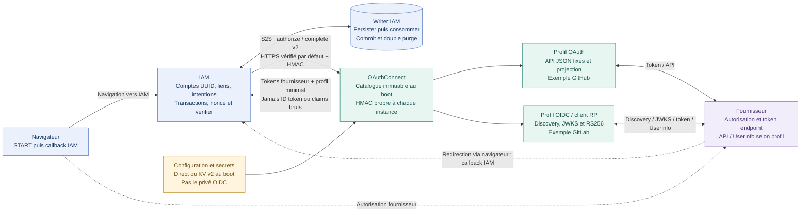
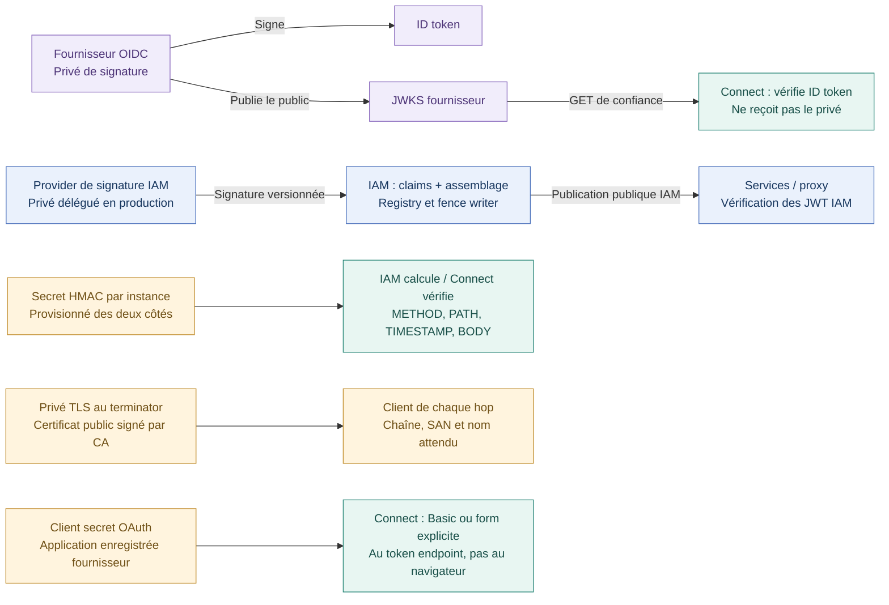
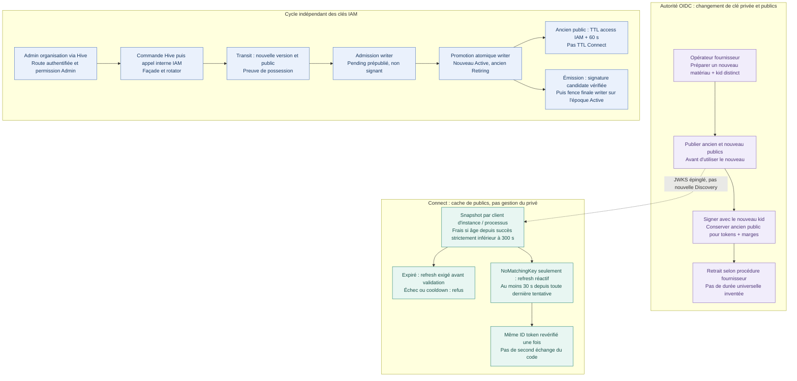
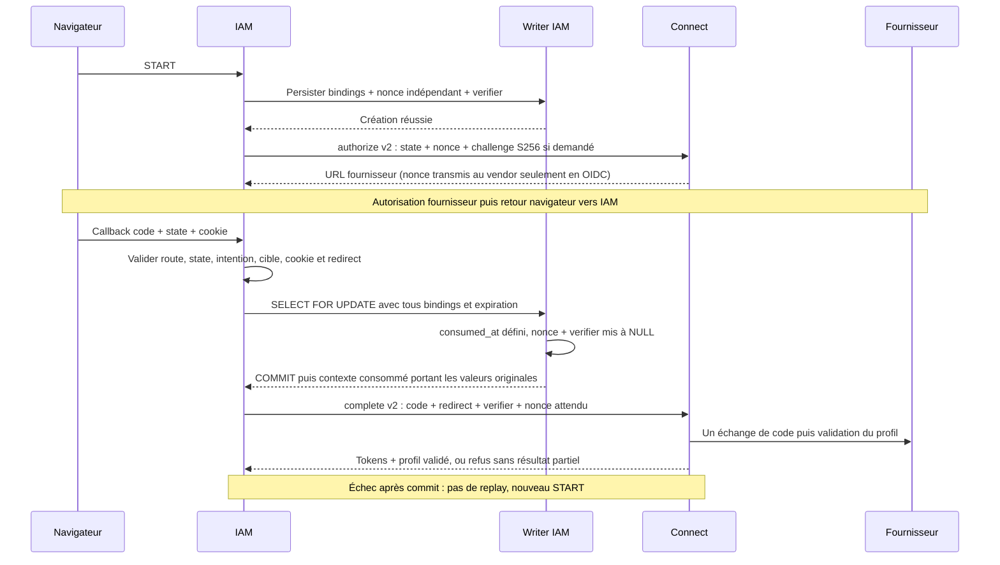

# IAM / OAuthConnect — cinq vues pour comprendre la sécurité

**Photographie pédagogique du 8 novembre 2026.**
[HTML autonome à cinq SVG](iam-oauthconnect-current.html) ·
[Sommaire de l'atlas](README.md) ·
[Guide détaillé](../guides/iam-oauthconnect-securite-clefs-jwks-tls.md) ·
[Sources et limites](../guides/iam-oauthconnect-securite-sources.md)

Les blocs Mermaid ci-dessous sont les sources logiques versionnées des cinq vues.
L'HTML porte leur composition SVG statique, dessinée explicitement pour une
lecture sans JavaScript ni réseau. Ce ne sont pas des captures d'un système live.

## Statut et légende

- Canon : [ADR0413](../adr/0413-oauthconnect-multi-instances-profils.md),
  **Accepted / Partial**, contrats [multi-instances](../contracts/oauthconnect-multi-instances.md),
  [OIDC/service](../contracts/oauthconnect-oidc-service-boundary.md) et
  [IAM v2](../contracts/iam-oauthconnect-v2.md).
- Acquis locaux rapportés : Connect 295 tests ; IAM 325 unités + 80 IT sur le
  périmètre de raccord. Aucun de ces tests n'est exécuté pour les dessins.
- Non qualifiés : G5 intégré, fournisseurs réels, équivalence `sub` GitLab,
  cutover et retrait legacy. Ni les clés privées ni les certificats live ne sont inspectés.
- Rôles : **bleu = IAM/Hive et état de compte**, **vert-bleu = Connect**,
  **violet = fournisseur**, **ambre = opération ou précaution**, **gris = transport/contexte**.
  Les étiquettes restent compréhensibles sans couleur.

## Vue 1 — Les frontières d'architecture et de confiance

**Question :** qui possède l'identité, et qui vérifie la réponse externe ?

### Ce que la vue affirme

- Un **slug d'instance** est une autorité logique stable, pas un Pod. Les
  replicas servent la même autorité mais possèdent des caches techniques locaux.
- La composition construit **tous** les clients et leurs secrets avant écoute,
  y compris Discovery/JWKS initial pour OIDC ; aucune readiness de catalogue partiel.
- Le navigateur ne détient pas le HMAC S2S et n'appelle pas directement ces routes.
  Les URL de callback et les comptes restent chez IAM.
- Le profil OAuth GitHub utilise les API JSON configurées ; ce n'est pas une
  validation par ID token/JWKS. Le profil OIDC vérifie son ID token puis projette
  seulement le profil minimal. UserInfo est conditionnel et lié au `sub` validé.
- L'AppState de support Connect contient un JWKS inline **vide**, sans autorité
  Bearer, utilisateur de secours ou acquisition de clés IAM ; les routes v2 ont
  leur middleware HMAC. Ce vide n'est pas le cache JWKS fournisseur.

**Preuves de lecture :** dossier de sources S01, S05–S10.
[Contrat HMAC-only §10](../contracts/oauthconnect-oidc-service-boundary.md#10-amendement--appstate-hmac-only-sans-autorité-jwt).
HTTPS décrit la politique par défaut, pas un constat de chaque hop déployé.

## Vue 2 — Les cinq familles de matériaux cryptographiques

**Question :** à qui appartient chaque secret ou clé, et quel public peut circuler ?

### Trois séparations à retenir

1. **Public ne veut pas dire dangereux à publier par nature** : le public RSA
   sert à vérifier, pas à signer. Le JWKS public ne contient pas le privé ni un
   secret HMAC, et ce n'est pas une liste d'utilisateurs.
2. **Signature ne veut pas dire chiffrement** : un JWT signé peut être lisible ;
   son contenu et sa qualité de credential justifient de ne jamais le journaliser.
3. **Même produit d'infrastructure ne veut pas dire même fonction** : OpenBao
   KV v2 résout ici les secrets de démarrage Connect ; Transit peut signer les
   JWT IAM. Le refresh JWKS ne relit pas les secrets du coffre.

**Responsabilités de renouvellement :** fournisseur pour ses clés OIDC ; cycle
IAM/provider pour les clés IAM ; administrateurs coordonnés pour le HMAC et le
client secret ; gestion du transport pour les certificats/CA TLS. Les noms
effectifs des équipes, coffres, fichiers privés et calendriers restent inconnus.

**Preuves :** sources S07–S09, S11–S16 ; guide §§2–4. Standards et liens primaires
N01–N11 sont regroupés dans le [dossier de sources](../guides/iam-oauthconnect-securite-sources.md#standards).

## Vue 3 — Rotation fournisseur, refresh Connect et cycle IAM

**Question :** quel composant renouvelle le privé, quel composant renouvelle sa vue ?

### Les conditions qui tiennent dans les sources, pas dans une flèche simplifiée

- Acquisition initiale = première fenêtre de cooldown. Toute tentative, succès
  **ou échec**, consomme la fenêtre ; aucune attente cachée de30s pour contourner
  un refus. Le single-flight et les générations coalescent les waiters localement.
- Un échec de refresh ne rajeunit pas le snapshot. Une **autre requête** peut encore
  utiliser une ancienne clé **fraîche** ; jamais une clé expirée de secours.
- Un matériau changé sous le même `kid` peut produire CryptoError : pas de
  refresh précoce promis. Ambiguïté, mauvais algorithme ou claim invalide ne
  déclenchent pas systématiquement un GET.
- Refresh = JWKS déjà épinglé, sans redécouverte ni URL choisie par un token.
  Le snapshot acquis remplace la vue, il ne conserve pas indéfiniment les clés retirées.
- Dans IAM, **le chemin de fabrication du successeur inspecté est Transit**.
  RemoteHttp peut avoir une capacité de signature sans capacité Rotate ; les
  noms cloud d'un enum ne prouvent pas une rotation livrée.
- Pending est publiable mais ne signe pas ; Active seul émet ; Retiring ne doit
  plus émettre ; Revoked n'est pas publié. La promotion et la publication sont
  atomiques sur writer, mais cela ne prouve pas la diffusion préalable à tous les caches.
- Rétention IAM : `updated_at + config.jwt.expiration_seconds + 60s > as_of` ;
  à la borne, Retiring n'est plus publiable. Ce n'est pas la durée du certificat
  ni le TTL300s Connect. Retrait public ≠ effacement physique du privé.
- La fence finale protège le retour d'une nouvelle émission après les awaits du
  signer ; elle ne révoque pas rétroactivement tous les JWT déjà retournés.

**Inconnus :** opérateur live, cron extérieur, CA et durée de chevauchement fournisseur.
La fonction background IAM inspectée lance outbox et cleanup OAuth, pas une
rotation périodique. Pas de promesse zéro downtime ou révocation instantanée.
Changer l'issuer est un changement d'autorité, **pas une rotation de clé**.

**Preuves :** sources S02–S04 et S11–S14 ;
[ADR0311](../adr/0311-crypto-privee-deleguee-aux-providers.md),
[ADR0304](../adr/0304-jwt-acces-plateforme-rs256-jwks.md),
[guide rotations](../guides/iam-oauthconnect-securite-clefs-jwks-tls.md#rotation-iam).

## Vue 4 — TLS par hop, HMAC par requête, signature par token

**Question :** quelle preuve établit chaque mécanisme ?

```mermaid
flowchart TB
    subgraph HOPS[Chaque connexion a ses pairs et son vérificateur]
        B[Navigateur] -->|Vérifie certificat du nom public IAM| E[Terminaison d'entrée<br/>Envoy ou service selon configuration]
        E -->|Autre connexion : qualifier TLS / mTLS ou exception HTTP| I[IAM backend]
        I -->|Client TLS IAM vérifie le serveur Connect| C[Connect ou son proxy]
        C -->|Client TLS Connect vérifie chaque origine admise| V[Discovery / JWKS / token<br/>UserInfo / API fournisseur]
    end
    subgraph PROOFS[Des preuves complémentaires, jamais interchangeables]
        T[TLS<br/>Identité serveur et confidentialité du canal<br/>CA + chaîne + SAN / nom attendu]
        H[HMAC d'instance<br/>Authenticité des octets de requête S2S<br/>METHOD + PATH + TIMESTAMP + BODY]
        J[Signature JWT<br/>Authenticité et intégrité du token<br/>Puis issuer, audience, nonce et temps]
    end
    subgraph HANDSHAKE[Handshake TLS 1.3 pédagogique, pas version live observée]
        CH[ClientHello<br/>SNI si applicable + part éphémère]
        SH[ServerHello + part éphémère<br/>Dérivation de secrets de session]
        CE[Certificat + preuve du privé<br/>Validation chaîne et identité attendue]
        FI[Finished<br/>HTTP protégé par clés symétriques AEAD]
        CH --> SH --> CE --> FI
    end
    classDef tls fill:#f0f3f7,stroke:#6a7d90,color:#273a4d;
    classDef connect fill:#e8f6f2,stroke:#218273,color:#174e47;
    classDef iam fill:#eaf1fc,stroke:#456dba,color:#17365e;
    classDef vendor fill:#f1edfb,stroke:#8361ba,color:#4d3477;
    class B,E,T,CH,SH,CE,FI tls;
    class I,J iam;
    class C,H connect;
    class V vendor;
```

### Ne pas dessiner un cadenas unique sur plusieurs connexions

La terminaison TLS déchiffre le HTTP. Le hop Envoy→backend est une autre
connexion : HTTPS en façade ne prouve pas TLS de bout en bout. Le navigateur
vérifie également le fournisseur pendant l'autorisation, indépendamment des
clients backend. Les liens coffre et signer IAM sont d'autres transports encore.

- **CA ajoutée :** étend explicitement la confiance du client concerné ; elle ne
  remplace pas la vérification SAN/hostname et n'authentifie pas un utilisateur IAM.
- **SNI :** aide à choisir le site/certificat ; ce n'est pas la preuve que le
  serveur possède une identité admise. La racine est une entrée de confiance
  locale, pas un objet rendu fiable parce que le serveur l'envoie.
- **mTLS :** ajoute l'authentification par certificat du client selon la politique
  du serveur ; ce n'est ni le HMAC v2, ni l'autorisation métier.
- **TLS1.3 :** exemple de handshake à certificat et échange éphémère ; pas
  assertion de version négociée par chaque composant du dépôt.
- **Rotation de certificat :** renouveler le leaf sous une CA admise n'est pas
  changer la CA. Un changement de CA nécessite la distribution de confiance
  côté clients avant la transition validée des certificats.
- **Exceptions :** Verified par défaut. Les modes vendor nonVerified peuvent
  désactiver vérifications de certificats/noms : ne pas les assimiler à une CA
  privée ajoutée. IAM→Connect conserve les vérifications HTTPS dans son builder,
  même si une exception explicite admet une URL HTTP pour un cas isolé.

Le dépôt et ses scénarios locaux contiennent des cas HTTP explicitement bornés ;
cela ne devient jamais une exception production implicite. Pas d'invention de
cert-manager, calendrier, responsable CA ou certificat live.

**Preuves :** sources S15–S17 ;
[guide TLS](../guides/iam-oauthconnect-securite-clefs-jwks-tls.md#tls),
[contrat0409](../adr/0409-confiance-callback-oauth-idp-connect.md).

## Vue 5 — Nonce / PKCE et la frontière irréversible du commit

**Question :** quelle autorité est nécessaire avant de rendre le verifier à Connect ?

Le nonce d'authentification est indépendant du state, du nonce de state, du cookie
et du verifier. Son attendu vient de la transaction persistée, jamais d'une valeur
que le navigateur choisirait au callback. La présence d'un nonce ne dispense pas
de vérifier la signature, l'issuer ou l'audience.

L'effacement SQL des deux secrets n'empêche pas la capacité consommée de porter
temporairement leurs valeurs originales jusqu'à la complétion. Il empêche une
nouvelle récupération depuis la même ligne. Timeout, erreur Connect ou échec
fournisseur après commit ne restaurent pas une transaction consommable.

Une ligne legacy correspondante sans nonce durable est consommée/purgée puis
refusée sans complete ; pas de génération de nonce au callback, de fallback v1
ou de réemploi du verifier conservé en DB. Les bindings incorrects restent intacts.

**Preuves :** sources S10 et S18 ;
[0412](../adr/0412-oauth-transaction-persistante-liee-navigateur.md),
[raccord IAM v2 §§3–4](../contracts/iam-oauthconnect-v2.md).

## Fabrication, accessibilité et contrôles

- Source de vérité factuelle : les deux guides et leur dossier de sources,
  base `eb32349be94a4211ee4e26ae64b88786a2df5604`. Les mêmes faits sont réutilisés,
  sans nouvelle campagne Rust ou inspection live.
- Les cinq SVG inline comportent titre et description accessibles. Leurs textes
  sont du texte, pas une image distante ; chaque mécanisme est également expliqué
  en Markdown et en prose HTML. Police système uniquement.
- Composition à coordonnées explicites, boîtes et couloirs séparés, textes courts
  sur plusieurs lignes, espacements réservés aux flèches. Le contrôle de géométrie
  et de ressources doit être distingué du rendu navigateur final par le parent.
- Aucun JS, Canvas, moteur Mermaid embarqué, dépendance CDN ou outil global ajouté.
- Aucun secret ni payload réel : les noms `kid`, nonce et verifier désignent des
  types de données, jamais des valeurs capturées.
- Les deux HTML historiques gardent leurs SVG et CSS originaux ; seuls un bandeau
  historique et des liens courants sont ajoutés. Les notices retirent leurs liens
  absolus de Canvas et expliquent la provenance locale sans dépendance au poste.

### Contrôles réellement réalisés

- Les cinq SVG sont des XML bien formés, chacun dans un `viewBox="0 0 1200 620"`,
  avec titre, description et identifiants uniques. Les boîtes de texte ont des
  coordonnées explicites `data-box` ; les cartes réservent généralement 16–18 unités
  de retrait horizontal au départ de leurs lignes.
- **Mesure des textes effectuée sur Windows** : Segoe UI, métriques typographiques
  System.Drawing en pixels, largeur majorée de 2 px, hauteur déterminée par ascente
  et descente de la police. Chaque texte a été testé contre sa boîte et contre
  tous les autres textes du même SVG. Résultat : vue 1 **53 textes**, vue 2 **65**,
  vue 3 **44**, vue 4 **42**, vue 5 **18** ; **zéro débordement et zéro intersection
  entre textes**, sur 222 textes. Le contrôle conserve au moins 2 px horizontalement
  et 1 px verticalement entre la boîte métrique majorée et la limite de son conteneur.
- Ce contrôle des positions/dimensions n'est **pas** un rendu navigateur, une
  mesure de toutes les polices de substitution ou une validation universelle de
  pagination. Il ne prétend pas analyser tout trait de flèche comme une boîte de
  texte. Les couloirs des flèches ont été composés séparément des lignes de texte.
- Sur les sept fichiers du dossier après livraison : **84 liens locaux** avec
  cibles et ancres retrouvées ; aucun asset externe, `<script>`, handler JS,
  iframe, image distante, police distante ou import CSS. Les marqueurs SVG
  utilisent exclusivement des références locales `url(#identifiant)`.
- Sources logiques : cinq blocs Mermaid et dix délimiteurs équilibrés. Aucun
  moteur Mermaid n'a été installé ou exécuté ; leur rendu reste à contrôler dans
  le lecteur du parent.
- Comparaison avec les versions Git initiales des deux HTML historiques : leurs
  **trois SVG et leurs deux blocs CSS sont byte-identiques**. Retirer les seuls
  nouveaux bandeaux reproduit exactement les fichiers initiaux ; aucune nouvelle
  photographie n'a écrasé les dessins appréciés.
- Les notices ne contiennent plus de lien absolu vers un Canvas local. Aucun
  espace de fin de ligne détecté ; `git diff --check -- docs/diagrams` sort 0 sur
  les modifications suivies, complété par lecture des nouveaux fichiers non suivis.
- Les deux guides gelés restent byte-identiques à leurs copies intégrées chez le
  parent. Aucun fichier hors `docs/diagrams/` n'a été écrit pendant cette tranche.

**À faire par le parent :** aperçu navigateur, contrôle des polices effectivement
utilisées, flèches, lisibilité en petit écran et pagination PDF. Aucun PASS visuel,
runtime ou E2E n'est déduit des contrôles statiques ci-dessus.
