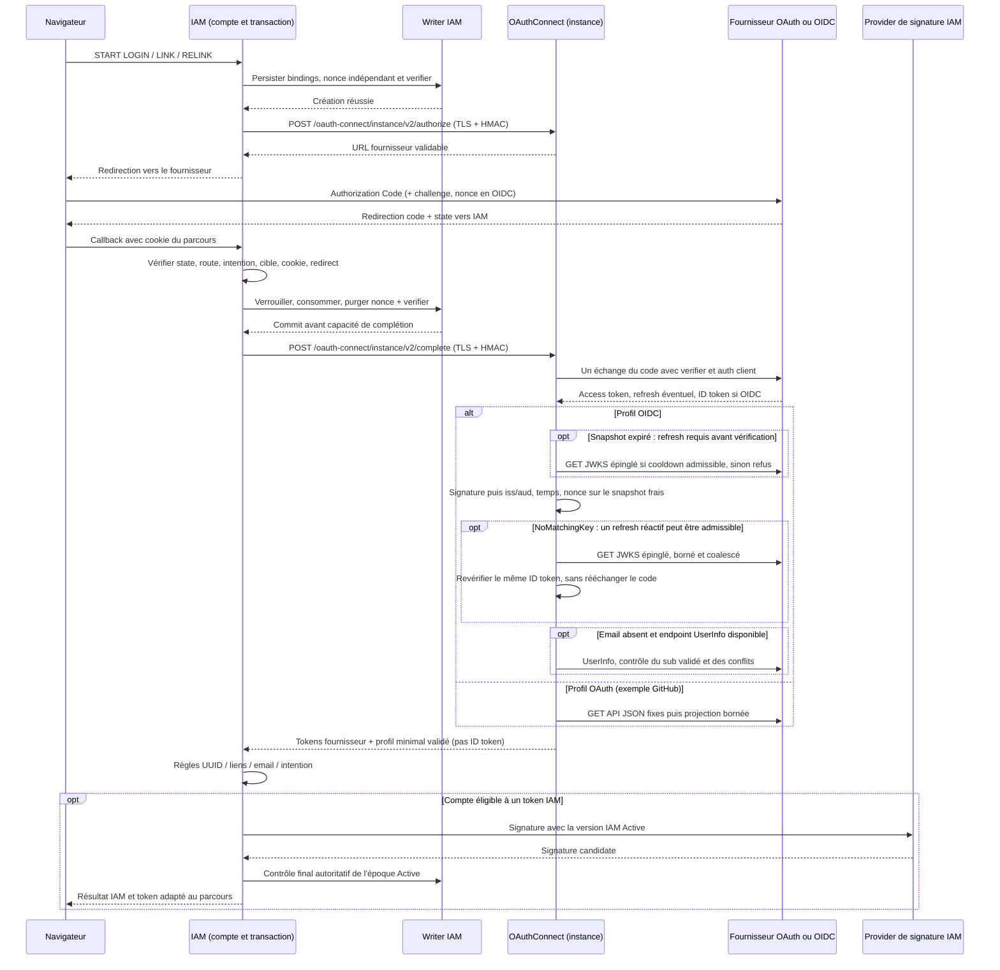
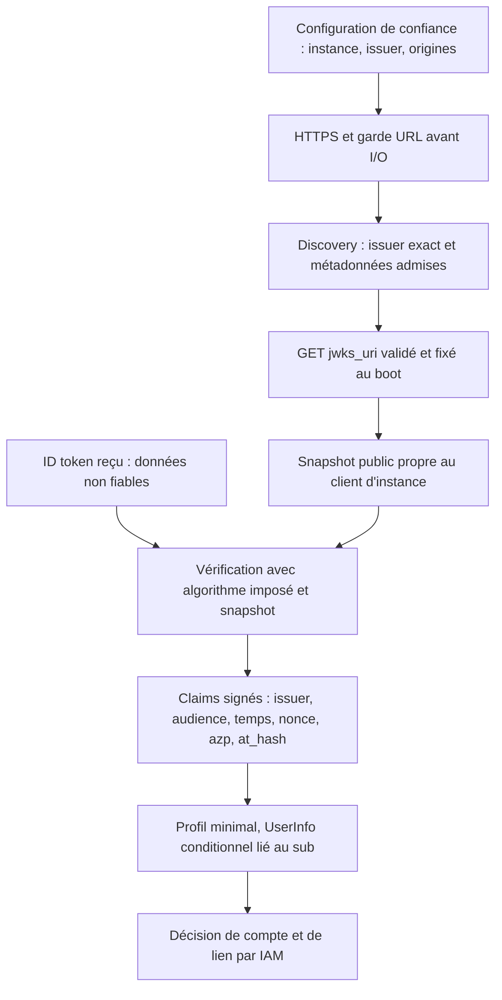
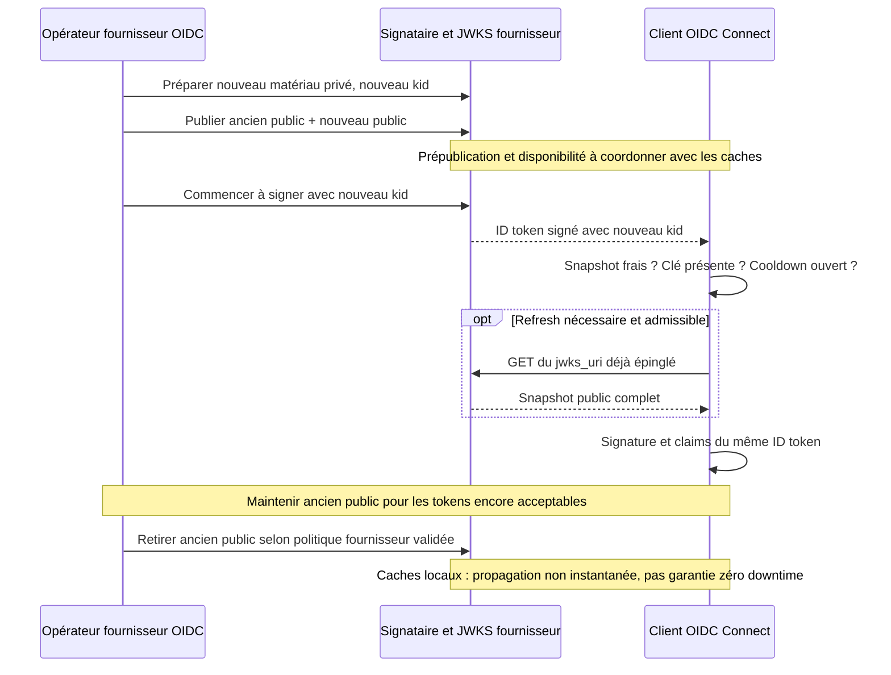
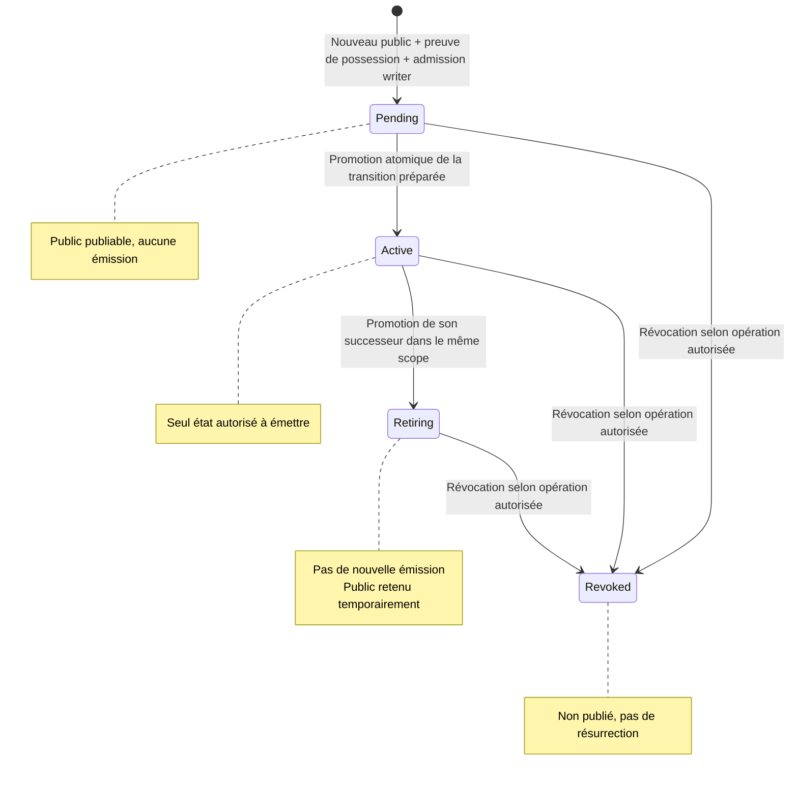
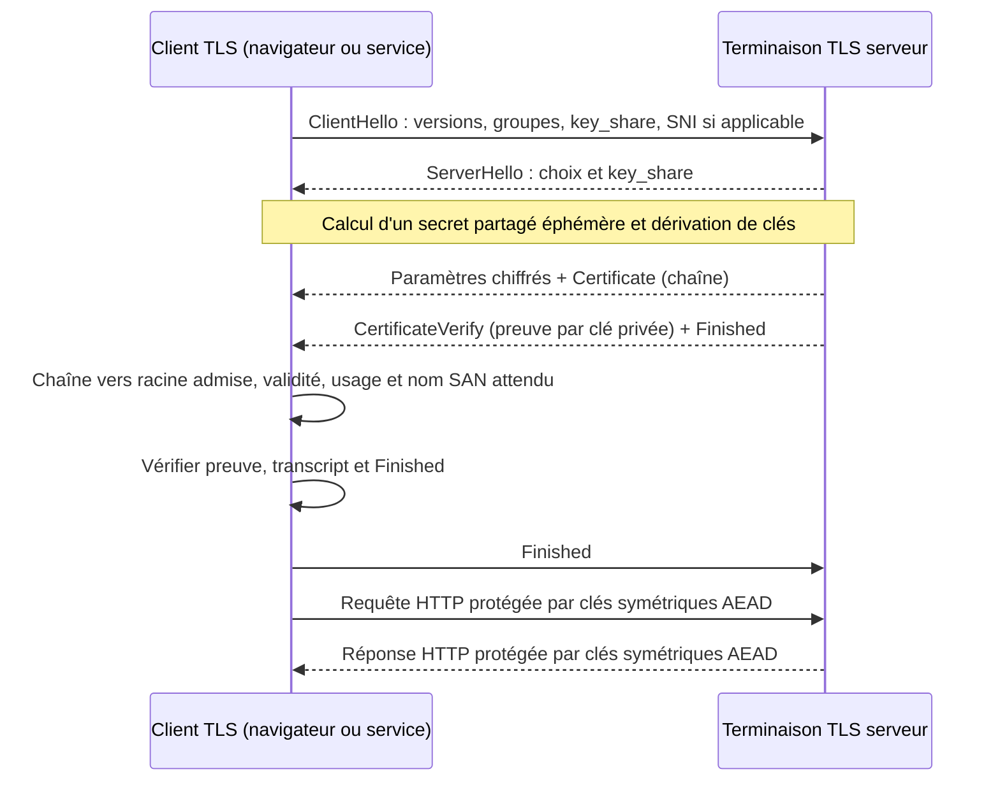
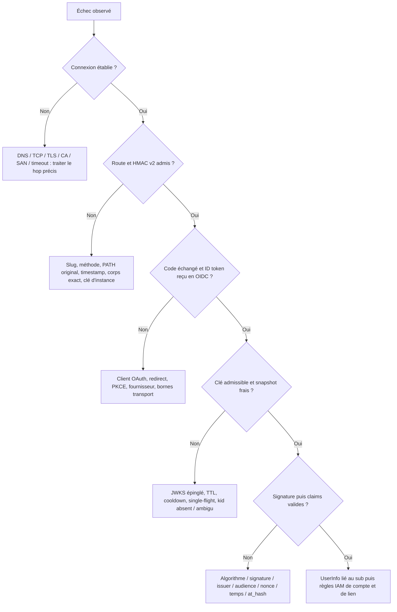

# Comprendre la sécurité IAM / OAuthConnect : clés, JWKS, rotation et TLS

**Lecture du 8 novembre 2026 — du premier login aux frontières cryptographiques.**

Ce guide explique les mécanismes, leurs propriétaires et leurs limites. Il ne
prescrit aucune rotation réelle et ne constate aucun déploiement en production.
Les références détaillées, symboles, lignes et limites de vérification sont dans
le [dossier de sources](iam-oauthconnect-securite-sources.md).

Le canon est [ADR-0413](../adr/0413-oauthconnect-multi-instances-profils.md),
**Accepted / Partial**, complété par les contrats
[multi-instances](../contracts/oauthconnect-multi-instances.md),
[OIDC/service](../contracts/oauthconnect-oidc-service-boundary.md) et
[raccord IAM v2](../contracts/iam-oauthconnect-v2.md), ainsi que
[0409](../adr/0409-confiance-callback-oauth-idp-connect.md) et
[0412](../adr/0412-oauth-transaction-persistante-liee-navigateur.md).
Une explication pédagogique ne remplace ni leurs décisions ni les contrôles du code.

## Parcours de lecture

- **Je débute** : [l'idée centrale](#idee-centrale), [les primitives](#primitives),
  [les tokens](#tokens), puis [le parcours complet](#parcours).
- **Je configure ou exploite** : [les cinq familles](#familles),
  [la rotation fournisseur](#rotation-oidc), [TLS](#tls), puis
  [la checklist](#checklist).
- **Je développe ou diagnostique** : [Discovery et validation](#validation),
  [le cache exact](#cache-connect), [la signature IAM](#rotation-iam) et
  [le diagnostic par frontière](#diagnostic).
- **Je veux vérifier une affirmation** : les repères S01–S18 du
  [dossier de sources](iam-oauthconnect-securite-sources.md#faits-locaux)
  séparent observation du code, contrat, résultat rapporté et inconnu.

## 1. L'idée centrale : plusieurs preuves, pas une seule « clé OAuth »

Dans un login fédéré, plusieurs questions différentes se succèdent :

1. **Avec quel serveur est-ce que je communique, et qui peut lire le trajet ?**
   C'est la frontière HTTPS/TLS.
2. **Cet appel backend est-il autorisé à utiliser cette instance Connect ?**
   C'est la frontière HMAC IAM → Connect.
3. **Ce résultat d'authentification a-t-il été signé par le bon fournisseur,
   pour notre client et notre transaction ?** C'est la validation OIDC.
4. **À quel compte local correspond cette identité externe ?** C'est le métier IAM.
5. **Qui a émis ce token d'accès à la plateforme ?** C'est la signature JWT IAM.
6. **Ce compte peut-il effectuer l'action demandée ?** C'est l'autorisation,
   distincte de l'authentification et non accordée par la seule présence d'un JWKS.

**JWKS est un annuaire de clés de vérification, pas un annuaire d'utilisateurs.**
La clé publique permet de vérifier une signature ; elle ne permet pas de signer
à la place du détenteur de la clé privée. La signature protège l'intégrité et
l'authenticité du message, **pas sa confidentialité**.

Connect est ici le **client OIDC**, aussi appelé *Relying Party* (RP). Il ne
devient pas un fournisseur d'identité parce qu'il lit des ID tokens. IAM conserve
les comptes, UUID, liens et transactions. Le fournisseur externe reste l'émetteur
de ses ID tokens. IAM émet ensuite ses propres tokens dans un autre domaine de confiance.

### Ce qui est livré, et ce qui n'est pas prouvé

Au point documentaire inspecté, le service OAuthConnect OAuth/OIDC est composé
et qualifié localement sur fixtures : **295 tests** rapportés. Le raccord IAM v2
LOGIN/LINK/RELINK est également livré et qualifié sur son périmètre local :
**325 unités + 80 IT** rapportées. Ce guide n'a réexécuté aucun de ces tests.

Ces nombres ne prouvent **ni** un fournisseur GitHub/GitLab réel, **ni** la chaîne
intégrée IAM → Connect réel → fournisseur simulé signé (gap G5), **ni** l'équivalence
du `sub` GitLab avec l'ancien identifiant, **ni** une bascule ou un retrait legacy.
Les notices du 7 novembre restent des photographies historiques, pas le dernier
état des sources. Voir les [résultats IAM](../missions/20261108-iam-oauthconnect-v2-results.md).

## 2. Les outils cryptographiques : quatre verbes à ne pas confondre

### 2.1 Encoder ne veut pas dire protéger

L'encodage base64url transforme des octets en caractères transportables. Il est
réversible sans secret. Dans un JWT signé de forme JWS compacte, les deux premiers
segments encodent l'en-tête et le contenu ; le troisième porte la signature ou le MAC.

Lire un contenu décodé ne prouve pas qu'il est vrai. Avant validation, un `iss`,
un `sub`, un `email` ou un `kid` reçu constitue une donnée fournie par l'expéditeur,
potentiellement malveillant. On ne copie jamais un token réel dans un décodeur
web public pour « voir ce qu'il contient ».

### 2.2 Hacher : produire une empreinte, pas une identité

Un hash cryptographique produit une empreinte d'une donnée. Sans secret, n'importe
qui peut recalculer ce hash. Il ne suffit donc pas à authentifier un appel.
Le hash est une brique utilisée dans les signatures, HMAC et PKCE ; ces constructions
ajoutent chacune leurs propres propriétés et conditions de sécurité.

### 2.3 Chiffrer : empêcher la lecture non autorisée

Le chiffrement protège la confidentialité. Dans un canal TLS moderne, les données
applicatives sont protégées avec des clés symétriques de session et un mécanisme
AEAD : chiffrement et contrôle d'intégrité des enregistrements.

Un JWT peut être chiffré dans un autre profil, JWE. **Ce n'est pas ce que signifie
RS256** : RS256 désigne une signature RSA/SHA-256, pas un chiffrement de l'ID token.
Le profil OIDC Connect étudié valide des ID tokens signés RS256 ; il ne faut pas
en déduire un support de tous les profils JWE ou de tous les algorithmes OIDC.

### 2.4 Signer : une clé privée produit, une clé publique vérifie

Une paire asymétrique comporte deux parties liées mathématiquement :

- la **clé privée**, réservée au signataire ou à son service cryptographique ;
- la **clé publique**, distribuable aux vérificateurs.

Le signataire signe les octets définis par le protocole. Le vérificateur contrôle
la signature sur **ces mêmes octets**, avec le bon algorithme et la bonne clé.
Une modification du message doit invalider la signature. La clé publique ne
permet pas raisonnablement de retrouver la clé privée avec les paramètres admis.

La vérification prouve une relation cryptographique avec une clé. Pour obtenir
une confiance utile, il faut encore savoir **à qui appartient cette clé**,
pour quel usage, quelle audience et quelle autorité elle est acceptée. C'est
pourquoi un JWKS arbitraire trouvé sur Internet ne doit jamais devenir de confiance.

### 2.5 MAC / HMAC : les deux côtés possèdent le même secret

Un MAC authentifie un message à l'aide d'un secret symétrique. HMAC-SHA-256 est
une construction de MAC fondée sur SHA-256. Les deux côtés qui connaissent le
secret peuvent produire le MAC : il n'existe pas de vérificateur purement public.

Le code peut appeler cette valeur une « signature HMAC », mais ce n'est pas une
signature asymétrique. Publier le secret HMAC permettrait de fabriquer les appels.
La propriété est donc différente de celle d'un JWKS public RSA.

**Règle mentale :** chiffrer empêche de lire ; signer/MAC empêche de modifier ou
fabriquer sans le secret approprié ; TLS protège un canal ; les règles métier
décident ensuite ce que l'identité authentifiée peut faire.

Références : [JWS, RFC7515 §§2–3](https://www.rfc-editor.org/rfc/rfc7515.html#section-2),
[JWT BCP §§3.1–3.3](https://www.rfc-editor.org/rfc/rfc8725.html#section-3.1),
[TLS1.3 §2](https://www.rfc-editor.org/rfc/rfc8446.html#section-2).

## 3. Les objets du parcours : token, clé, claim et transaction

### 3.1 JWT, JWK, JWKS : trois niveaux différents

- **JWT** : conteneur de claims, c'est-à-dire d'affirmations. Le profil dicte
  les claims attendus et la protection à valider. « C'est un JWT » ne signifie
  pas « c'est un token d'accès IAM acceptable ».
- **JWK** (*JSON Web Key*) : représentation JSON d'une clé et de métadonnées.
  Pour une clé RSA publique, `n` et `e` représentent ses paramètres publics ;
  `kty` indique la famille de clé. `alg`, `use` ou `key_ops` peuvent préciser
  l'usage, selon le profil.
- **JWKS** (*JWK Set*) : objet contenant un tableau `keys` de JWK. Il peut
  contenir plusieurs clés pendant une rotation.
- **`kid`** (*Key ID*) : identifiant permettant de sélectionner une clé parmi
  les clés admissibles. Ce n'est ni un utilisateur, ni un secret, ni une URL
  de téléchargement. Il n'est pas globalement unique entre fournisseurs.

Le format JWK général peut aussi représenter des secrets symétriques et des
clés privées. Cela n'autorise évidemment pas à les publier : **le JWKS public
de vérification dont parle ce guide ne doit contenir que du matériel public**.
Ne pas y publier de paramètres privés RSA ni de secret symétrique `k`.

Une JWK peut comporter une chaîne X.509 `x5c`. Ce mécanisme optionnel ne transforme
pas tout JWKS en magasin de certificats HTTPS : l'usage, la confiance et la
validation restent ceux du protocole concerné. Un certificat TLS présenté par
le serveur web et une clé de signature d'ID token peuvent être entièrement différents.

Référence : [RFC7517 §§4–5](https://www.rfc-editor.org/rfc/rfc7517.html#section-4).

### 3.2 Issuer, audience et subject

- **`iss` / issuer** : autorité émettrice attendue. En OIDC, l'issuer configuré,
  celui de Discovery et celui de l'ID token doivent correspondre exactement.
  Un nom ressemblant ou une autre URL n'est pas une équivalence autorisée.
- **`aud` / audience** : destinataire prévu du token. L'ID token externe vise
  le `client_id` enregistré chez ce fournisseur, pas arbitrairement l'API IAM.
- **`sub` / subject** : identifiant du sujet dans le domaine de cet issuer.
  L'email n'est pas un substitut universel à cet identifiant.
- **Claims** : autres affirmations, par exemple expiration `exp`, émission
  `iat`, date minimale `nbf`, nonce, email et statut de vérification de l'email.
  Leur simple présence ne remplace pas leur validation.

Dans le modèle Connect/IAM, le **slug d'instance** stable, tel `gitlab`, désigne
une autorité logique configurée ; ce n'est pas le nom d'un Pod. Plusieurs replicas
peuvent servir cette autorité. IAM conserve le lien instance/provider + identifiant
externe vers son UUID local. Deux instances peuvent avoir un même `kid` ou `sub`
sans être la même autorité.

### 3.3 ID token, access token et refresh token externes

L'**ID token** sert à l'authentification du sujet auprès du client OIDC. Connect
en valide la signature, la provenance, le destinataire et la liaison au parcours.
Il ne le renvoie pas comme identité brute à IAM et ne le signe pas lui-même.

L'**access token fournisseur** autorise des accès aux ressources du fournisseur,
selon ses scopes et sa durée. Il peut être opaque ou structuré. Connect ne doit
pas le traiter comme un ID token sur le seul motif qu'il ressemble à un JWT.
Son utilisation pour UserInfo ne dispense pas de vérifier le `sub` reçu.

Le **refresh token fournisseur**, s'il est émis, permet au client de demander de
nouveaux tokens au serveur d'autorisation. Ce n'est ni une clé de signature, ni
un token à envoyer à chaque API. La rotation des refresh tokens est un sujet
distinct : elle ne signifie pas rotation de la paire RSA ou du certificat TLS.
Ce guide n'annonce pas de politique fournisseur ou de qualification d'un parcours
refresh live non inspecté.

Références : [OIDC Core §2](https://openid.net/specs/openid-connect-core-1_0.html#IDToken),
[OAuth2 §§1.4–1.5](https://www.rfc-editor.org/rfc/rfc6749.html#section-1.4),
[BCP OAuth §2.2.2](https://www.rfc-editor.org/rfc/rfc9700.html#section-2.2.2).

### 3.4 Le JWT IAM est un autre token

Après validation externe et décision métier, IAM peut produire un **token
d'accès plateforme**, signé selon son propre cycle de clés. Le canon RS256 décrit
notamment `typ=aiforall-access+jwt`, `aud=aiforall` et un issuer dérivé de
`public_base_url` avec `/iam` ; ce sont des règles de la plateforme, pas les claims
à imposer au fournisseur OIDC externe. La valeur effective de `public_base_url`
d'un déploiement n'a pas été observée ici.

Un ID token GitLab valide ne devient donc pas directement un JWT d'accès IAM.
Un token de registration IAM n'est pas interchangeable avec un token d'accès.
Les vérificateurs doivent distinguer les types et leurs règles :
[RFC8725 §3.12](https://www.rfc-editor.org/rfc/rfc8725.html#section-3.12).

### 3.5 State, cookie, PKCE et nonce ne sont pas des clés JWKS

- Le **state** et ses liaisons IAM rattachent le retour au parcours attendu.
- Le **cookie navigateur** lie ce parcours au navigateur qui l'a commencé.
- **PKCE S256** lie l'échange du code à un verifier conservé côté IAM ; le
  challenge est envoyé au départ, le verifier seulement lors de la complétion.
- Le **nonce d'authentification OIDC** est une valeur IAM aléatoire indépendante,
  persistée dans la transaction et comparée au claim signé de l'ID token.

Ici, IAM génère 32 octets indépendants pour ce nonce, encodés en base64url sans
padding. Il ne le dérive ni du state, ni du cookie, ni du verifier. Le nonce
attendu vient du contexte durable consommé, **pas du navigateur au callback**.
Le profil OAuth reçoit le contexte v2 mais ne transmet pas de nonce OIDC au vendor.

Ces protections se complètent. Un nonce correct ne répare pas une signature
invalide ; un HMAC correct ne répare pas une transaction navigateur rejouée ;
une signature correcte ne prouve pas que le token était destiné à ce client.
Le nonce choisi ici est une défense explicite de0413, pas une obligation
universelle de tous les Authorization Code flows OIDC.

## 4. Cinq familles de matériaux : qui génère, garde, utilise et renouvelle ?

### Famille A — Les clés de signature du fournisseur OIDC

**Fonction :** signer les ID tokens externes, puis permettre leur vérification.

- **Génération et conservation privées :** fournisseur OIDC ou infrastructure
  cryptographique qu'il administre. Connect et IAM ne reçoivent pas cette clé privée.
- **Utilisation privée :** signataire du fournisseur.
- **Publication publique :** endpoint `jwks_uri` annoncé par ses métadonnées
  Discovery, sous l'autorité de l'issuer configuré et des origines admises.
- **Consommateur ici :** client OIDC d'instance dans Connect, qui met en cache
  les clés publiques et vérifie l'ID token.
- **Rotation :** opérateur du fournisseur, pas le cache Connect. Pour un service
  SaaS, c'est l'opérateur SaaS ; pour une instance autogérée, son équipe habilitée.
- **Inconnu local :** version fournisseur, fréquence, chemin de stockage privé,
  HSM éventuel, procédures, équipe nominative et durée de chevauchement.

Ne pas confondre le login OIDC d'un fournisseur avec ses tokens de jobs CI : un
autre type de token peut avoir une autre autorité, une autre clé et une autre procédure.

### Famille B — Les clés de signature JWT IAM

**Fonction :** signer les tokens émis par IAM, indépendamment du fournisseur externe.

- **Responsabilité produit :** IAM possède les claims, en-têtes, bindings,
  décisions d'activation, registry publique et publication JWKS.
- **Opérations privées en production :** déléguées selon0311 au provider
  cryptographique configuré, sans exporter le privé vers IAM.
- **Implémentations à distinguer :** Transit, remote signer et PEM explicite
  dev/test ne possèdent pas tous les mêmes capacités ; les noms AWS/GCP/Azure
  dans un enum ne prouvent pas une intégration livrée.
- **Consommateurs :** vérificateurs des tokens IAM, notamment services/proxy
  selon leur configuration. Connect n'en devient pas un vérificateur Bearer actif.
- **Rotation livrée inspectée :** orchestration IAM et provider Transit,
  prépublication puis promotion. Voir [le cycle exact](#rotation-iam).
- **Inconnu live :** provider réellement choisi, coffre et credentials déployés,
  responsable opérationnel, déclencheur périodique éventuel et état des clés actives.

### Famille C — Le secret HMAC IAM → Connect, propre à une instance

**Fonction :** authentifier les requêtes S2S v2 sur la bonne route d'instance.

- **Provisionnement :** administrateur habilité des deux côtés ; les fonctions
  de setup inspectées résolvent les secrets, elles ne fabriquent pas une nouvelle
  clé partagée à chaque boot.
- **Conservation/utilisation :** IAM calcule le MAC ; le récepteur Connect le
  vérifie avec le secret correspondant à l'instance. Les deux possèdent donc du secret.
- **Données couvertes :** méthode HTTP, **PATH complet d'origine**, timestamp,
  corps exact. Fenêtre temporelle ±30 s, borne incluse.
- **Publication :** aucune publication publique. Ce secret ne doit jamais entrer
  dans un JWKS, un schéma d'exemple ou un log.
- **Rotation :** changement coordonné des configurations/secrets IAM et Connect,
  avec admission et redémarrage selon leurs contrats. Le code inspecté ne démontre
  pas une double-clé ou un hot-reload permettant un chevauchement sans interruption.

La fenêtre temporelle HMAC n'est pas le cooldown JWKS de30s : même nombre, deux
mécanismes sans relation. Ce HMAC ne chiffre pas le corps et ne remplace pas HTTPS.
Il ne fournit pas, à lui seul, une preuve de non-rejeu unique de chaque requête
pendant sa fenêtre ; les capacités transactionnelles IAM restent indispensables.

### Famille D — Les clés et certificats TLS

**Fonction :** authentifier le serveur du hop réseau et protéger le canal.

- **Génération privée :** serveur, gestionnaire de certificats ou outil de
  provisionnement selon l'infrastructure. Une CA signe le certificat ; elle
  ne doit pas nécessairement recevoir la clé privée du serveur.
- **Conservation privée :** composant qui termine TLS, par exemple Envoy ou le
  listener du service, ou son gestionnaire de secrets.
- **Publication :** certificat et chaîne présentés pendant le handshake ; jamais
  la clé privée. Les racines publiques de confiance sont distribuées aux clients.
- **Consommateurs :** navigateur ou client HTTP qui vérifie le serveur ; en mTLS,
  le serveur vérifie aussi un certificat client.
- **Rotation :** gestionnaire TLS/équipe Ops selon l'environnement. Cert-manager,
  ACME, fournisseur de CA et calendrier ne sont pas établis par cette lecture.

### Famille E — Le `client_secret` OAuth/OIDC

**Fonction :** authentifier l'application cliente au token endpoint fournisseur.

- **Provisionnement :** enregistrement de l'application chez le fournisseur et
  distribution par les administrateurs habilités. Ce guide n'invente pas lequel
  des intervenants génère effectivement sa valeur dans le fournisseur réel.
- **Conservation/utilisation ici :** secret résolu au boot de Connect, directement
  ou via OpenBao KV v2/SDK ; client HTTP du profil OAuth/OIDC.
- **Transmission :** méthode déclarée Basic ou `client_secret_post`, sur le canal
  admis. Basic est un encodage d'authentification HTTP, pas un chiffrement autonome.
- **Publication :** aucune, ni JWKS ni navigateur.
- **Rotation :** coordonnée entre application enregistrée chez le fournisseur,
  source de secrets et redémarrage des clients Connect ; pas le refresh JWKS.

Le setup conserve les octets du secret OAuth **sans trim**. Le HMAC est au
contraire normalisé au point de résolution, puis conservé tel quel. Mélanger les
deux traitements peut casser l'authentification sans aucun défaut de cryptographie.

### Même coffre ne veut pas dire même cycle de vie

**OpenBao KV v2** sert ici à lire des secrets de configuration au démarrage.
**OpenBao Transit** peut effectuer des opérations privées de signature IAM.
Un même produit d'infrastructure peut héberger ces fonctions, mais elles ont
des API, permissions, matériaux et consommateurs différents.

Mettre à jour une valeur KV ne prouve pas qu'un client déjà démarré l'a relue.
Faire tourner une clé Transit ne prouve pas que sa nouvelle version est admise
et active dans la registry IAM. Aucun de ces actes ne renouvelle un certificat TLS.

## 5. Un login de bout en bout : suivre chaque preuve

Le diagramme suivant représente le **parcours logique livré localement**, non
une capture réseau de production. Les connexions HTTPS sont des canaux distincts.
L'issuer fournisseur et le signataire IAM ne sont pas la même autorité.

### Pourquoi consommer avant l'appel externe ?

Le callback ne doit pas transformer un code reçu en capacité librement rejouable.
Le writer recherche une transaction correspondant à **tous** ses bindings, non
expirée et non consommée, avec verrouillage. Il efface `authentication_nonce`
et `pkce_verifier` de la ligne consommée dans la même transaction, puis commit.
La capacité retournée possède temporairement les valeurs originales nécessaires
à une seule complétion dans l'orchestration.

Un timeout ou un refus Connect après cette consommation ne remet pas la ligne en
état consommable. Il faut un nouveau START, pas un retry du callback ou un fallback
v1. Une ligne legacy dont le nonce manque, mais dont les bindings correspondent,
est consommée et purgée puis refusée sans complétion ; IAM ne fabrique pas de nonce
de secours au retour.

### Pourquoi IAM garde-t-il le métier ?

Connect fournit une authentification externe normalisée, pas un compte IAM.
En LOGIN, l'email reste requis avant les recherches métier ; ensuite le lien
provider + identifiant prime, et le rapprochement par email est encadré par sa
provenance vérifiée. LINK/RELINK ont leurs règles d'intention et de cible propres.
Un `email_verified=true` ne donne pas une permission générale de fusionner des comptes.

GitHub OAuth utilise les API de profil et emails configurées : **pas de validation
d'identité par ID token/JWKS dans ce profil**. Le choix accepté ne conserve que
l'email primaire déclaré, sans l'ancien fallback public `/user.email`. GitLab
OIDC utilise le `sub` signé ; sa correspondance avec l'ancien ID doit être prouvée
sur le fournisseur réel avant cutover, pas déduite de la forme d'un token de fixture.

## 6. Comment Connect apprend et valide les clés OIDC

### 6.1 Une chaîne de confiance, pas une URL fournie par le token

Au démarrage, la configuration d'une instance fixe notamment l'issuer, le
`client_id`, les redirect URI et les origines réseau permises. Le client fait
Discovery, valide les métadonnées et acquiert un JWKS initial **avant** que le
catalogue complet puisse être servi. Si une instance échoue, pas de catalogue
partiel présenté comme prêt ; des lectures de coffre/Discovery déjà effectuées
ne sont pas pour autant annulées rétroactivement.

Le callback HTTP garde chaque URL **avant** la requête, y compris le GET JWKS
effectué à l'intérieur de Discovery. Les redirects ne sont pas suivis par le
builder Connect. Le refresh n'est pas une nouvelle Discovery : issuer et endpoints
restent attachés au client. Une URL `jku`/`x5u` dans un en-tête de token ne devient
pas une nouvelle source de confiance. Cette séparation évite d'aller chercher
la « clé qui valide » à une adresse choisie par l'attaquant.

Référence : [Discovery §4.3](https://openid.net/specs/openid-connect-discovery-1_0.html#ProviderConfigurationValidation).

### 6.2 Une bonne signature est nécessaire, mais insuffisante

Le chemin vérifié utilise la bibliothèque standard avec **RS256 seul**, pas tous
les algorithmes que le token ou Discovery proposent. Il contrôle notamment :

1. une signature vérifiable avec une clé admissible, non une clé ambiguë choisie
   arbitrairement dans le tableau ;
2. l'issuer épinglé et l'audience correspondant au `client_id` ; les audiences
   supplémentaires ne sont pas implicitement approuvées ;
3. le nonce attendu depuis IAM ;
4. `exp > maintenant`, l'émission `iat` au plus60s dans le futur et `iat <= exp` ;
5. `nbf`, s'il est présent, non futur ;
6. `azp`, s'il est présent, égal au `client_id` ;
7. `at_hash`, s'il est présent, correspondant à l'access token retourné, avec
   l'algorithme et la clé réellement utilisés pour vérifier l'ID token.

L'UTC des claims et le temps monotone du cache ont des usages séparés. Les60s
de borne future `iat` ne sont ni un délai de rotation, ni une grâce de60s ajoutée
à `exp` : le code refuse l'expiration à l'égalité.

Si l'email manque et que UserInfo est disponible, un seul appel conditionnel est
fait, lié au `sub` déjà validé. Des champs contradictoires ne sont pas fusionnés
en un profil « plus riche ». Aucun profil ni token partiel n'est retourné avant
la fin de la validation.

Références : [OIDC Core §3.1.3.7](https://openid.net/specs/openid-connect-core-1_0.html#IDTokenValidation),
[JWT BCP §§3.8–3.12](https://www.rfc-editor.org/rfc/rfc8725.html#section-3.8).
Les bornes supplémentaires ci-dessus sont celles du **code local**, pas des
constantes universelles OIDC.

## 7. Le cache JWKS Connect, exactement

### 7.1 Ce qui est conservé

`KeyCache` conserve en mémoire un snapshot immuable des clés publiques, la date
du dernier succès, la dernière tentative, une génération et le résultat de
refresh. Les clones du **même client d'instance** partagent cet état et une garde
single-flight. Un autre client d'instance ou un autre processus a son propre état.

Ce cache n'est ni une DB, ni OpenBao, ni Redis, ni un cache de comptes ou de
transactions authorize→complete. Un restart le perd et refait l'acquisition initiale.
Il n'exige pas de sticky-session. Il n'est pas un rate limiter distribué entre replicas.

### 7.2 Les deux horloges qui gouvernent les acquisitions

- **Fraîcheur :** âge depuis le dernier succès **strictement inférieur à300s**.
  À300s exactement, le snapshot est expiré.
- **Cadence des tentatives :** au moins **30s** depuis la précédente tentative,
  qu'elle ait réussi ou échoué. La première acquisition initialise aussi cette
  fenêtre ; un nouveau `kid` juste après le boot peut donc être refusé.
- Les échecs et les hits ne repoussent pas la date du dernier succès.
- Aucun job périodique ne rafraîchit ce cache en arrière-plan : les futures des
  requêtes possèdent leurs acquisitions.

**300s n'est pas une fréquence de rotation des clés privées.** Sans requête,
aucune rotation ni acquisition périodique n'est impliquée par ce TTL.

### 7.3 Ordre de décision

1. **Avant vérification**, obtenir le snapshot courant. S'il est expiré,
   demander un refresh admissible ; échec ou cooldown ⇒ refus, même si la clé
   cherchée figurait dans l'ancien snapshot.
2. **Snapshot frais :** tenter la vérification normale. Une clé connue et une
   signature/claims valides permettent le succès sans GET JWKS.
3. **Seulement `NoMatchingKey`** peut demander le refresh réactif. Celui-ci doit
   encore respecter le cooldown et le single-flight. Après succès, vérifier
   à nouveau **le même ID token**, au plus une fois supplémentaire.
4. **Erreur cryptographique avec clé trouvée, ambiguïté, algorithme interdit ou
   claim invalide :** refus ; pas un GET de secours pour chaque erreur.
5. Si le refresh requis échoue, la requête qui en avait besoin échoue. Une
   **autre requête**, signée par une ancienne clé toujours présente et dont le
   snapshot est encore frais, peut néanmoins réussir. Cela ne rajeunit pas le cache.

L'échange POST du code n'est pas répété pour réessayer la signature. Le client
protocolaire standard est reconstruit en mémoire à partir du **snapshot retenu**,
afin que le verifier et UserInfo signé ne restent pas bloqués sur les clés du boot.

### 7.4 Ce que single-flight signifie réellement

Une seule tâche effectue le GET de refresh à un instant donné pour ce client.
Les autres attendent la garde puis recontrôlent la génération et le résultat :
elles ne lancent pas chacune leur GET après avoir attendu. Une acquisition échouée
consomme la fenêtre ; les waiters ne la contournent pas. Si le propriétaire est
annulé, la garde est libérée ; il n'y a pas de tâche détachée à oublier ni de flag
in-flight éternel. Une nouvelle tentative reste soumise à sa fenêtre.

Le snapshot n'est pas verrouillé pendant une I/O ou une vérification JWT. La
garde async de sérialisation du refresh peut, elle, rester détenue pendant le GET.

### 7.5 Quatre exemples sans ambiguïté

**Nouveau `kid`, 10s après un boot réussi :** le cache est frais, mais la fenêtre
de30s n'est pas ouverte. L'absence de clé n'autorise pas une acquisition immédiate
ni une acceptation du token sans signature.

**Nouveau `kid`, 40s après la dernière tentative :** un GET admissible peut
rapporter la clé ; le même ID token est alors revérifié, sans rééchanger le code.

**Nouveau matériau sous le même `kid` :** si la clé est trouvée mais ne valide
plus la signature, c'est une erreur cryptographique, pas `NoMatchingKey`. Aucun
refresh précoce n'est promis ; un nouveau snapshot peut être acquis à expiration.
Il faut coordonner des `kid` distincts lors d'une rotation normale.

**Fournisseur JWKS en panne :** une ancienne clé fraîche peut encore valider ses
tokens ; à l'expiration du snapshot, échec de refresh ⇒ refus. Il n'existe pas
de dernier-bon-snapshot accepté sans borne. Une clé retirée du JWKS fournisseur
n'est pas nécessairement oubliée instantanément par tous les replicas.

Les tests privés vérifient notamment ces bornes, les échecs, l'annulation et
l'absence de refresh sur ambiguïté. Leur lecture ici n'est pas une nouvelle
exécution de ces tests. Voir S02–S04 dans les [sources](iam-oauthconnect-securite-sources.md#faits-locaux).

## 8. Rotation OIDC : le fournisseur change la clé, Connect renouvelle sa vue

La rotation asymétrique normale décrite par
[OIDC Core §10.1.1](https://openid.net/specs/openid-connect-core-1_0.html#RotateSigKeys)
combine publication, changement de signature et conservation temporaire des
anciens publics. Le schéma suivant est pédagogique, pas une procédure fournisseur exécutée.

### Qui décide de la durée de chevauchement ?

Le fournisseur et ses opérateurs connaissent les durées des tokens, les caches,
les marges et leur procédure de retrait. Le protocole ne donne pas ici un nombre
universel à copier. Les300s/30s de Connect informent la coordination mais ne
constituent pas, seuls, une durée de conservation sûre des anciens publics.

Une prépublication sans délai ni observation des consommateurs ne garantit pas
qu'ils ont tous chargé le nouveau public. Un nouveau `kid` peut encore rencontrer
un cooldown, une panne réseau ou un replica redémarré. Il n'y a donc **aucune
promesse zéro interruption**, même avec un déroulé conceptuellement correct.

### Retrait, révocation et compromission

Le **retrait normal** laisse aux tokens déjà émis le temps d'expirer selon la
politique retenue. La **révocation d'urgence** cherche à supprimer la confiance
plus vite après compromission et peut casser des authentifications encore actives.
Ni la signature mathématique ni le format JWKS ne fournissent une révocation
instantanée de tous les tokens hors ligne.

Ce guide n'invente pas de mécanisme d'introspection, de push de révocation ou
de purge distribuée absent du parcours inspecté. Un incident exige une procédure
fournisseur et une analyse du système réellement déployé ; ce n'est pas un simple
changement de TTL dans le guide.

### Changer l'issuer n'est pas faire tourner une clé

Une rotation conserve l'autorité et renouvelle son matériau. Changer l'issuer
change l'autorité de confiance et potentiellement l'espace des `sub`.
Le contrat interdit de remplacer silencieusement l'autorité sous le même slug.
Une nouvelle autorité exige un nouveau cadrage d'instance et des liens de comptes,
pas un reset de cache qui ferait croire les identités équivalentes.

## 9. Le cycle des clés IAM : indépendant de celui du fournisseur

### 9.1 Trois responsabilités séparées

1. **Provider cryptographique :** conserve/gère le privé et effectue les opérations
   privées selon ses capacités. En production,0311 exclut le privé exporté dans IAM.
2. **Registry/lifecycle IAM sur writer :** décide quel binding public est admis,
   prépublié, actif, en retrait ou révoqué. Le binding comprend notamment owner,
   issuer, `kid`, algorithme, référence provider et version.
3. **Publication et vérificateurs :** IAM publie une vue publique autoritative ;
   services/proxy en consomment des snapshots selon leur propre politique.

**Une rotation du provider ne suffit pas à activer une nouvelle clé IAM.**
La registry ne fait pas confiance à « la dernière version » implicitement. La
version utilisée pour le public, la preuve de possession et la signature est épinglée.

### 9.2 États et transitions observés

La rotation inspectée demande un nouveau matériau au provider, récupère son
public versionné, prouve la possession puis prépare un `Pending` durable. La
promotion vérifie la révision, le binding préparé et l'ancien Active attendu.
Elle passe le nouveau en Active, l'ancien en Retiring et met à jour la publication
dans la même transaction writer.

La prépublication existe donc comme phase réelle. En revanche, le helper de
rotation enchaîne préparation et promotion : **ce n'est pas la preuve d'une attente
de diffusion dans chaque cache consommateur**. Aucun délai de prépublication
opérationnel nouveau n'est décidé par ce guide.

### 9.3 Chevauchement et retrait : le nombre vient d'IAM, pas de Connect

Le filtre IAM publie les clés Pending et Active. Une clé Retiring reste
publiable tant que :

`date_de_retrait + expiration_seconds_des_access_tokens_IAM + 60s > horloge_de_référence`

Il refuse notamment une date de retrait future dans ce filtre. À l'égalité de
fin de rétention, l'ancien public ne fait plus partie de la publication admissible.
Les60s viennent de `JWKS_RETIRE_SKEW_SECONDS`. La valeur effective de
`config.jwt.expiration_seconds` dépend de la configuration : **ne pas lui
substituer les300s du cache OIDC Connect**, ni affirmer900s pour tout déploiement.

La publication matérialisée est lue avec l'horloge primaire ; si elle est sale,
expirée ou incompatible avec la politique, le repository effectue le rafraîchissement
autoritatif nécessaire. Ce retrait d'une vue publique n'implique pas l'effacement
physique immédiat de la ligne registry ou du privé dans le provider.

### 9.4 Qui déclenche réellement la rotation IAM ?

Un **chemin applicatif d'administration organisation** est présent dans Hive :
sa route `POST /api/organizations/{organization_id}/signer/rotate` est déclarée
authentifiée avec permission **Admin sur l'organisation**. Le handler construit
`RotateOrganizationSignerCommand` depuis le principal authentifié ; son handler
application appelle le port IAM puis persiste le statut reçu. L'adapter HTTP
sortant vise `/iam/internal/organizations/{org_id}/signer/rotate`. Les préfixes
de montage des services s'ajoutent selon leur router ; ces chemins de code ne
sont pas des URL de production observées.

Côté IAM, le chemin HTTP inspecté expose l'opération interne
`POST /internal/organizations/{org_id}/signer/rotate`, avec contrôle de token de
service interne, puis façade application et rotator. Le router peut ajouter son
préfixe de service : ce chemin de handler n'est pas une instruction d'appel live.

Cela permet de répondre précisément « par qui ? » au niveau du produit :
**demande d'un principal autorisé via Hive, appel interservice vers IAM, orchestration
IAM et opération privée Transit** dans la capacité de rotation inspectée.
Ce guide n'a exercé ni l'authentification, ni OpenFGA, ni les credentials S2S de
ce chemin ; une déclaration de route n'est pas une preuve dynamique de ces gardes.

Le rotator sait traiter un scope et le code contient un chemin plateforme ainsi
que des tests dédiés. **Cela ne prouve pas l'existence d'une route d'administration
plateforme identique**, ni qu'un cron ou Envoy appelle ce chemin en production.
Le bootstrap est distinct : il ne doit pas remplacer silencieusement une époque
déjà enregistrée lors d'un redémarrage.

Dans `start_background_tasks` inspecté, les tâches sont l'outbox et le cleanup
OAuth ; aucune rotation périodique de clés n'y apparaît. Ce constat limité ne
prouve pas l'absence d'un orchestrateur extérieur. Le nom du responsable, la
fréquence, la délégation humaine et les automatisations réellement déployées
restent **inconnus**. Envoy, en tant que vérificateur/terminaison réseau, n'est
pas présenté comme créateur automatique des clés IAM.

### 9.5 Transit, remote signer et capacités effectivement présentes

Le code de rotation inspecté n'accepte que **OpenBaoTransit** pour fabriquer
le successeur. Il appelle la rotation du provider, récupère une nouvelle version
et son public, puis fait la preuve avant l'admission. Les branches RemoteHttp,
AWS/GCP/Azure retournent `ProviderNotSupported` pour cette opération ; même le PEM
local explicitement permis ne devient pas une fonction de génération de successeur.

Cela ne signifie pas que toute signature RemoteHttp est impossible : le setup
dispose d'une composition de signature distante. **Signer et savoir faire Rotate
sont deux capacités différentes.** Un matériel externe peut aussi relever d'un
enrôlement/configure avec preuve selon le contrat applicable, sans que cette
lecture qualifie une rotation remote automatique ou un HSM/cloud réel.

Le setup plateforme distingue binding Transit, configuration remote et chemin
local explicitement autorisé. Il n'effectue pas de fallback silencieux vers un
PEM si le provider configuré échoue. Le déploiement effectif n'est pas observé.

### 9.6 Émission en vol : contrôle final, pas « bail éternel »

Un appel au provider peut prendre du temps. Pendant cet `await`, la registry
peut promouvoir ou révoquer une clé. Le codec IAM inspecté :

1. charge et contrôle l'époque Active et son binding public ;
2. fait signer avec ce binding ;
3. vérifie la signature candidate contre le public enregistré ;
4. demande un **contrôle autoritatif final writer** avant de retourner le token.

Ainsi, une ancienne sélection locale ne suffit pas à émettre après un changement
observé par la fence finale. Ce contrôle ne constitue pas une révocation rétroactive
de tous les JWT déjà retournés. Ne pas le présenter comme un verrou maintenu sur
toute la durée réseau, ni comme un signing lease distribué qui gèlerait tous les
consommateurs. Aucun tel service de bail autonome n'est établi dans ce chemin
inspecté ; s'il existe ailleurs dans l'exploitation, il reste à documenter séparément.

### 9.7 Publication HTTP IAM : registry autoritative, même vide

Le handler JWKS passe par `GetJwksCommand`, puis `TokenUseCaseImpl::get_jwks`,
qui lit la publication du registry writer. Un résultat public valide **vide** est
autoritatif ; il ne doit pas faire republier une clé bootstrap qui aurait été révoquée.
Une panne/corruption du writer est une erreur, pas un succès vide fabriqué.

Il existe aussi une méthode `JwtTokenEncoder::jwks` au niveau du codec ; ce n'est
pas une raison pour attribuer son comportement au publisher HTTP actuel. Il faut
suivre le consommateur réel jusqu'à sa source de vérité.

Enfin, la politique de cache des **consommateurs IAM** est distincte de celle de
Connect :0304/0308 décrivent notamment un âge maximal autoritatif60s et des polls
selon environnement. Ces prescriptions ne sont pas ici une qualification de chaque
proxy/service live. Les300s/30s de la section7 ne s'y transfèrent pas.

## 10. TLS expliqué sans magie

### 10.1 Ce que promet HTTPS — et ce qu'il ne promet pas

HTTPS utilise TLS pour authentifier le pair serveur et protéger les échanges sur
**une connexion donnée**. Il n'affirme pas que le serveur a appliqué les bonnes
règles de compte, ni qu'un JWT est valide pour notre audience. Une réponse de
légitime serveur peut être refusée pour nonce incorrect ; un JWT mathématiquement
valide peut transiter sur un canal qui n'est pas celui attendu.

La protection suppose notamment des clés non compromises, une bonne configuration
de confiance et la vérification correcte du nom. « Chiffré » sans authentification
du bon serveur peut laisser parler à un attaquant.

### 10.2 Un handshake TLS1.3 typique, avec certificat serveur

Il s'agit d'une explication du protocole, **pas d'une preuve que chaque hop du
dépôt négocie effectivement TLS1.3**. Les reprises PSK et0-RTT ont d'autres détails
et ne sont pas représentées ni qualifiées ici.

1. Le client annonce ses paramètres et une part publique d'échange éphémère.
   Le SNI, lorsqu'il est utilisé, aide le serveur à sélectionner le site/certificat.
   **SNI n'est pas lui-même une preuve d'identité** ; on ne suppose pas ici ECH
   ni confidentialité du nom dans tout ClientHello.
2. Le serveur fournit sa part ; les deux côtés dérivent des secrets de session.
   Dans ce handshake à échange éphémère, la clé privée du certificat n'est pas
   utilisée pour « déchiffrer tous les paquets HTTPS ».
3. Le serveur présente son certificat et généralement ses intermédiaires.
   `CertificateVerify` démontre la possession du privé correspondant par une
   signature liée au transcript du handshake.
4. Le client valide la chaîne vers une racine **déjà de confiance**, les dates,
   contraintes et usages applicables, et le nom attendu dans le SAN. Le serveur
   ne peut pas rendre sa propre racine fiable en l'envoyant simplement.
5. `Finished` protège l'intégrité du handshake et confirme les clés. Les données
   HTTP utilisent ensuite des clés symétriques de trafic dérivées, pas une
   signature RSA indépendante de chaque octet applicatif.

Le contrôle de révocation des certificats dépend aussi de la pile et de sa
politique ; cette lecture ne prouve pas OCSP/CRL/stapling actifs partout.

Références : [RFC8446 §2](https://www.rfc-editor.org/rfc/rfc8446.html#section-2),
[CertificateVerify §4.4.3](https://www.rfc-editor.org/rfc/rfc8446.html#section-4.4.3),
[Finished §4.4.4](https://www.rfc-editor.org/rfc/rfc8446.html#section-4.4.4),
[validation X.509 RFC5280 §6](https://www.rfc-editor.org/rfc/rfc5280.html#section-6),
[identité de service RFC9525 §6](https://www.rfc-editor.org/rfc/rfc9525.html#section-6).
Le [BCP TLS RFC9325 §3.1.1](https://www.rfc-editor.org/rfc/rfc9325.html#section-3.1.1)
exclut notamment SSL et TLS1.0/1.1 : ce n'est pas une permission de les réactiver
pour résoudre un incident.

### 10.3 CA, certificat, SAN, hostname, SNI : qui fait quoi ?

- **CA** : autorité de certification qui atteste un lien entre un public et des
  identifiants/usages, selon sa politique.
- **Certificat serveur** : document public signé par une CA, contenant le public,
  les identifiants et des contraintes. Ce n'est pas la clé privée.
- **Chaîne** : certificat serveur et intermédiaires permettant de rejoindre une
  racine de confiance. La racine de confiance est une entrée locale du vérificateur.
- **SAN** : identifiants présentés, par exemple DNS ou IP. Une connexion vers une
  IP ne devient pas valide parce qu'un autre nom DNS est dans le certificat.
- **Hostname attendu** : identité que le client voulait joindre, établie depuis
  sa configuration/URL fiable, pas inventée depuis ce que le serveur présente.
- **SNI** : indication de nom dans la négociation, utile au routage TLS ; elle ne
  remplace pas la comparaison du nom et de la chaîne côté client.

Ajouter une CA privée approuvée signifie étendre explicitement le magasin de
confiance du client concerné. **Cela ne dispense jamais du hostname/SAN.**
Importer un certificat au hasard ou accepter tous les certificats n'est pas
une méthode équivalente pour faire confiance à une CA privée administrée.

### 10.4 Qui vérifie le certificat sur chaque hop ?

**Navigateur ↔ entrée IAM :** le navigateur est client TLS ; il vérifie la
terminaison présentée pour le nom public IAM. Cette terminaison peut être Envoy
ou un autre composant d'entrée, pas nécessairement le processus IAM. L'URL de
callback, le routage et les cookies sécurisés doivent être cohérents avec ce hop.

**Navigateur ↔ fournisseur :** le navigateur vérifie séparément le certificat du
fournisseur pendant l'autorisation. Cette réussite ne valide pas automatiquement
les connexions backend de Connect : autre processus, autre URL, autre magasin de confiance.

**IAM ↔ Connect :** IAM est le client HTTP/TLS, le serveur Connect ou son proxy
présente le certificat. Le constructeur IAM garde la vérification des certificats
et noms ; ses racines supplémentaires sont locales à ce client et étendent le
magasin par défaut. Le mode `Verified` impose HTTPS. Le HMAC s'ajoute après le
choix de cette frontière, il n'en fait pas disparaître le besoin.

**Connect ↔ Discovery / JWKS / token / UserInfo / API vendor :** Connect est client
HTTP/TLS et valide chaque serveur joint. Les origines admises limitent les
destinations possibles, mais ne remplacent pas les contrôles de certificat.
Le builder vendor désactive proxies ambiants, redirects et retries automatiques ;
le plafond de lecture décompressée reste une garde supplémentaire, non un contrôle TLS.

**IAM ↔ provider de signature ou accès coffre :** ce sont encore d'autres
connexions, avec leurs credentials et politiques. Ce guide distingue leur rôle
sans prétendre avoir qualifié tous les transports, trust stores ou coffres live.

### 10.5 TLS simple, mTLS et HMAC ne sont pas synonymes

En TLS usuel, le certificat serveur authentifie le serveur ; le client peut
s'authentifier ensuite au niveau applicatif. En **mTLS**, un certificat client et
une preuve de possession permettent aussi au serveur de vérifier le client selon
sa politique. Ce certificat client n'est pas automatiquement un compte IAM ou une
permission métier.

Le HMAC v2 authentifie ici la requête avec un secret partagé d'instance. Il ne
prouve pas l'emploi de mTLS. Réciproquement, constater mTLS sur un hop ne prouve
pas que les vérifications HMAC du PATH/corps ont été effectuées.

### 10.6 Terminaison Envoy : une frontière de confiance réelle

Si Envoy termine TLS, il déchiffre le HTTP et peut lire les données à cette
frontière. Le lien Envoy → backend est **une autre connexion**. Il peut être
TLS/mTLS vérifié ou HTTP explicite selon la configuration ; le premier hop HTTPS
ne chiffre pas magiquement le second.

Il faut donc documenter séparément les noms, certificats, racines et vérificateurs
des deux côtés. On ne dessine pas un cadenas « de bout en bout » en se fondant
uniquement sur un listener d'entrée TLS ou un manifeste d'exemple.

Le dépôt contient des scénarios locaux et historiques où le navigateur utilise
HTTP, et0413 signale des anciennes liaisons Compose IAM→Connect en HTTP. Les
contrats exact-route/Envoy bornent leurs preuves ; ils ne qualifient pas une
production TLS globale. **Configuration cible, configuration versionnée et
état réellement négocié sont trois objets différents.** Aucun état live n'a été
interrogé pour ce guide.

### 10.7 Exceptions locales : nommer le risque au lieu de le masquer

Le profil vendor définit `Verified` par défaut, et deux exceptions explicites
`LocalInsecure` / `IsolatedTest`. Dans le builder Connect inspecté, un mode non
Verified peut autoriser HTTP et désactive aussi l'acceptation stricte des
certificats/noms pour son client. Ce n'est pas l'équivalent d'une CA privée
ajoutée en mode Verified. L'exception n'est pas inférée du mode de compilation.

Le constructeur IAM→Connect inspecté ne désactive, lui, pas la validation TLS :
son mode peut admettre une URL HTTP selon la politique, mais son client HTTPS
construit continue de vérifier certificats et noms. Ne pas attribuer à toutes
les couches le comportement exact du builder vendor.

HTTP loopback peut servir une fixture explicitement isolée. **Localhost n'est
pas une preuve générale de sécurité ni une exception de production.** Ne jamais
réparer un échec CA/SAN en activant un mode insecure dans une configuration
partagée ou en généralisant `danger_accept_invalid_*`.

### 10.8 Rotation TLS : deux plans, encore différents des JWKS

**Renouveler un certificat serveur sous une CA déjà admise :** préparer le
certificat et le privé adéquats, vérifier noms/usages/chaîne et capacité de reload
du terminator, puis vérifier les connexions. Les détails relèvent de l'outil et
de la procédure Ops réels, non établis ici.

**Changer la CA de confiance :** il faut d'abord distribuer la nouvelle confiance
aux clients concernés, coordonner la transition des certificats, puis retirer
l'ancienne confiance selon le plan validé. Sinon un certificat neuf parfaitement
signé devient inconnu d'une partie des clients.

Cette coexistence de confiance ressemble à un chevauchement JWKS, mais les objets
et validateurs sont différents : trust stores X.509 d'un côté, clés/issuer/claims
JWT de l'autre. Les300s/30s du cache Connect ne gouvernent ni renouvellement TLS,
ni propagation des racines, ni rechargement du listener.

## 11. Diagnostiquer par frontière, sans affaiblir la sécurité

Avant de tester une hypothèse, repérer **quelle preuve a réellement échoué**.
Les erreurs publiques sont volontairement génériques : un401 ou502 isolé ne
désigne pas à lui seul une cause cryptographique.

### « Certificat inconnu » ou « nom incorrect »

Identifier le client qui refuse : navigateur, IAM ou Connect. Contrôler l'URL
attendue, les SAN, les dates, la chaîne et les racines de **ce client**. Une CA
installée dans le navigateur ne prouve pas qu'elle est installée dans le client
reqwest concerné. Ne pas chercher d'abord un `kid` : TLS peut échouer avant tout HTTP.

### « HMAC refusé »

Contrôler méthode, instance/slug, PATH complet reçu, timestamp et horloges, octets
du JSON réellement envoyés, correspondance et normalisation du secret. Un proxy
qui réécrit le chemin peut invalider le MAC. Ne pas retirer le préfixe de la
signature pour faire passer une route qui ne correspond plus au contrat.

Ne pas afficher les secrets ni le corps porteur de code/verifier/nonce pour
comparer : préférer des assertions de fixture ou des métadonnées expurgées.

### « `kid` introuvable »

Vérifier l'instance et l'issuer de confiance, la provenance du snapshot, sa date
de succès, la dernière tentative et le JWKS publié par l'autorité attendue.
Un nouveau `kid` peut être légitime mais tomber dans le cooldown. Une clé déjà
retirée n'est pas à remettre manuellement depuis un token non fiable.

### « Signature invalide alors que le `kid` existe »

Vérifier le matériau et l'algorithme admis ; un `kid` réutilisé pour un nouveau
public n'est pas une absence de clé. Le refus sans refresh anticipé peut être
le comportement attendu. Ne pas faire accepter le token avec `alg=none`, HS256,
une clé choisie librement ou un décodage sans vérification.

### « Mauvais issuer / audience / nonce »

Ces erreurs sont distinctes de la signature. Vérifier respectivement l'autorité
exacte, l'application enregistrée et le contexte transactionnel IAM original.
Ne pas prendre la valeur reçue pour corriger automatiquement la valeur attendue.
Après consommation writer, repartir d'un START plutôt que rejouer le callback.

### « Login externe valide, mais refus IAM »

Examiner le profil normalisé et l'intention métier : email absent en LOGIN,
identité liée ailleurs, cible LINK/RELINK, compte incomplet, contraintes de
persistance. Ni un JWKS valide ni TLS n'autorisent à contourner ces règles.

### « IAM ne peut plus émettre »

Distinguer provider Sign indisponible, binding/version incorrects, époque
non Active, admission/promotion refusée et fence finale ayant vu un changement.
Un nouveau public fournisseur OIDC ne répare pas le signer IAM. Un fallback
PEM ou une réactivation de clé révoquée serait un changement de sécurité, pas
un diagnostic acceptable.

## 12. Checklist de lecture et d'exploitation préparatoire

**Liste de préparation, non exécutée.** Elle n'autorise ni commande de rotation,
ni accès à un coffre, ni changement de configuration live.

### Avant de dessiner ou expliquer le système

- [ ] Nommer séparément issuer OIDC externe et issuer JWT IAM.
- [ ] Dessiner le callback sur IAM, pas sur Connect.
- [ ] Montrer IAM propriétaire des comptes, transactions, intentions et nonce attendu.
- [ ] Séparer les flèches de navigation et les appels backend HMAC.
- [ ] Dessiner les clés publiques allant du JWKS au vérificateur ; aucun privé
  fournisseur ne part vers Connect.
- [ ] Montrer les deux profils : OAuth API JSON et OIDC standard.
- [ ] Ne pas dessiner de JWKS IAM de confiance installé dans l'AppState Connect :
  son extracteur de support utilise un ensemble **vide**, strictement refusant.
- [ ] Dater la photographie et distinguer code livré, preuves locales et cible déployée.

### Avant une rotation fournisseur à préparer avec ses responsables

- [ ] Identifier l'autorité, le produit/version et la procédure officielle réels.
- [ ] Identifier le détenteur privé et l'équipe habilitée, sans supposer un chemin/HSM.
- [ ] Connaître durées de tokens, `kid` distinct, prépublication et ancien public.
- [ ] Prévoir les caches propres à chaque replica, cooldown, redémarrages et pannes JWKS.
- [ ] Prévoir la conduite de retrait normal ou de compromission, sans garantir
  une révocation instantanée ou un rollback vers une clé révoquée.
- [ ] Conserver issuer et identité ; traiter un changement d'autorité séparément.

### Avant une évolution du signer IAM à préparer séparément

- [ ] Identifier scope plateforme/organisation, provider, binding et version épinglée.
- [ ] Vérifier les capacités réellement supportées : Sign n'implique pas Rotate.
- [ ] Vérifier admission, preuve, Pending, promotion writer et publication autoritative.
- [ ] Lire le TTL IAM effectif et les60s de skew, sans copier le TTL Connect.
- [ ] Identifier le déclencheur et son authentification, sans déduire un cron d'un handler.
- [ ] Distinguer fence d'émission, propagation chez les vérificateurs et effacement privé.

### Avant un changement de transport ou certificat à préparer avec Ops

- [ ] Décomposer chaque hop et son terminator TLS réel.
- [ ] Identifier nom attendu/SNI/SAN, chaîne, racines et identité du vérificateur.
- [ ] Vérifier si l'amont proxy→service est TLS/mTLS ou HTTP explicitement isolé.
- [ ] Distinguer renouvellement leaf, rotation privée et changement de CA.
- [ ] Vérifier reload/redémarrage du composant concerné et distribution des racines.
- [ ] Ne pas affaiblir la validation des certificats ou noms pour masquer un incident.
- [ ] Qualifier séparément les tests locaux et la négociation réelle du déploiement.

## 13. FAQ : les raccourcis trompeurs

**« Le JWKS est public : tout le monde peut usurper un utilisateur ? »**
Non. Il contient les publics nécessaires à la vérification, pas le privé qui
permet de produire la signature. Cela n'empêche pas qu'un token volé soit sensible :
protection des tokens, scopes et durées restent nécessaires.

**« Le JWT est signé : je peux le mettre dans les logs ? »**
Non. Signé ne signifie pas chiffré, et un token d'accès peut être réutilisable
par son porteur. Ne pas publier JWT, code, nonce, verifier, tokens ou credentials.

**« Les mêmes300s s'appliquent à toutes les clés ? »**
Non. C'est le TTL local de fraîcheur du cache public OIDC Connect. Il ne fixe ni
la rotation privée fournisseur, ni le retrait IAM, ni la validité TLS, ni le refresh token.

**« Modifier le secret dans OpenBao actualise immédiatement Connect ? »**
Pas selon ce chemin : les secrets métier sont résolus au boot et conservés en
snapshot. Une relecture JWKS publique n'est pas une relecture du `client_secret`.

**« HTTPS remplace le contrôle de signature de l'ID token ? »**
Pas dans ce profil local. Il impose la validation cryptographique RS256 et les
claims. TLS protège l'acquisition ; la signature protège le message selon son
profil. On ne retire aucun contrôle en invoquant une possibilité générale du standard.

**« HMAC prouve quel utilisateur humain appelle Connect ? »**
Non. Il authentifie la requête backend autorisée pour l'instance. L'identité
humaine vient du parcours et du profil validé ; les intentions et cibles restent
dans la transaction IAM.

**« Connect accepte un Bearer IAM grâce à son AppState ? »**
Non. L'AppState contient le support requis par le SDK, construit ici avec
`{"keys":[]}`. Aucune clé, identité par défaut ou acquisition JWKS IAM n'en fait
une autorité Bearer. Les routes v2 sont protégées par leur HMAC commun.

**« Le fournisseur a renouvelé son certificat : faut-il changer le JWKS ? »**
Pas intrinsèquement. Le certificat HTTPS et la clé de signature d'ID token sont
deux matériaux distincts. Il faut examiner lequel a changé et quelle confiance
est affectée ; une CA différente peut nécessiter un rollout des racines TLS.

**« Un JWKS contient zéro clé : utilisons la clé du boot ? »**
Pas comme règle générale. Le publisher IAM traite une publication writer valide
vide comme autoritative, pour ne pas ressusciter une clé révoquée. Le cache vendor
Connect refuse un nouveau JWKS vide comme refresh réussi et ne rajeunit pas son
ancien snapshot. Son AppState inline vide a encore un autre rôle : ne faire
confiance à aucun Bearer. Même syntaxe JSON, trois contextes différents.

**« Les295 +405 tests prouvent le parcours de production ? »**
Non. Ne pas agréger des suites de périmètres différents en certification globale.
Les fixtures signées prouvent des propriétés locales ; les mocks S2S IAM ne
ferment pas G5, et aucun chiffre ne remplace l'E2E fournisseur ou le cutover.

## 14. Glossaire de poche

- **AEAD** : chiffrement authentifié avec données associées, utilisé pour protéger
  les enregistrements d'un canal TLS moderne.
- **Audience** : destinataire attendu du token, à valider selon le profil.
- **Autorité logique** : instance stable de confiance ; distincte du processus qui la sert.
- **Binding** : association exacte de paramètres qui doit rester cohérente ;
  par exemple owner/issuer/kid/public/provider/version pour la signature IAM.
- **CA** : autorité de certification X.509.
- **Claim** : affirmation nommée dans un token ; non fiable avant validation.
- **Client OAuth** : application enregistrée auprès du serveur d'autorisation,
  pas nécessairement le navigateur humain.
- **Cooldown** : intervalle minimal entre tentatives d'acquisition du cache Connect.
- **Discovery** : obtention et validation des métadonnées de l'issuer OIDC.
- **Fail closed** : absence de preuve requise ⇒ refus, pas succès dégradé implicite.
- **Fence d'émission** : contrôle final autoritatif avant de rendre un token signé.
- **Issuer** : autorité émettrice ; différent d'une clé et d'un nom de Pod.
- **JWK / JWKS** : représentation d'une clé / ensemble de ces représentations.
- **JWS / JWE** : message protégé par signature ou MAC / message chiffré.
- **`kid`** : identifiant de sélection d'une clé, pas une autorité à lui seul.
- **mTLS** : TLS avec authentification par certificat des deux pairs selon politique.
- **Nonce OIDC** : valeur transactionnelle comparée dans l'ID token signé.
- **PKCE** : preuve liant l'échange du code au verifier du client.
- **Prépublication** : exposition du nouveau public avant son usage actif.
- **Relying Party** : client qui s'appuie sur l'authentification d'un fournisseur OIDC.
- **SAN** : noms/identifiants présentés dans un certificat.
- **Single-flight** : coalescence locale d'acquisitions concurrentes en un seul travail en vol.
- **Snapshot** : vue immuable retenue pour une opération ; pas une autorité éternelle.
- **SNI** : indication du nom serveur dans la négociation TLS.
- **TTL** : durée de validité/fraîcheur d'un objet précis, à toujours nommer.
- **Writer** : source primaire de l'état transactionnel, pas une lecture replica.

## Pour poursuivre

- [Sources, preuves, écarts et inconnus](iam-oauthconnect-securite-sources.md)
  — vérifier une affirmation ou mettre ce guide à jour.
- [Schéma d'architecture historique du7novembre](../diagrams/oauthconnect-architecture.md)
  et [clés/responsabilités historique](../diagrams/oidc-keys-responsibilities.md)
  — utiles visuellement, à lire avec leur date ; leurs anciens statuts ne
  remplacent pas la photographie courante présentée ici.
- [ADR0311 : délégation de la crypto privée](../adr/0311-crypto-privee-deleguee-aux-providers.md)
  et [ADR0304 : JWT plateforme/JWKS](../adr/0304-jwt-acces-plateforme-rs256-jwks.md)
  — cycle IAM, distinct du client OIDC Connect.
