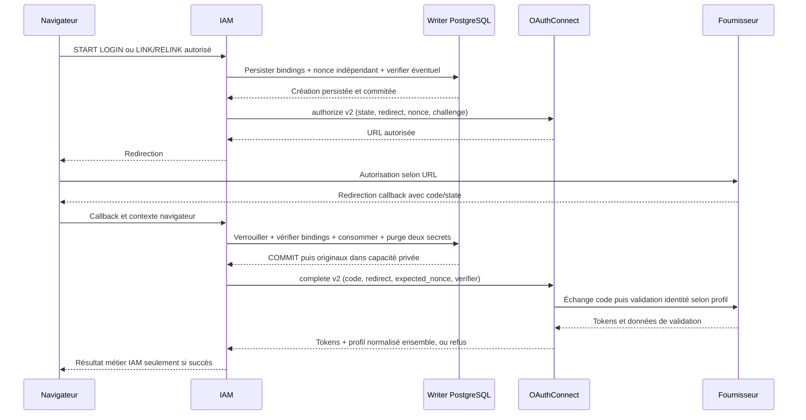

# Contexte durable IAM pour OAuthConnect v2

## Le problème à résoudre

OIDC demande au client de confronter l'identité signée à un contexte d'authentification attendu. Le code reçu au callback ne suffit pas à recréer ce contexte ; le navigateur ne doit pas choisir le nonce attendu, le verifier ou le compte cible. En environnement multi-replica, conserver les corrélations uniquement en RAM ne suffit pas non plus.

Le raccord laisse donc le contexte métier chez [[projects/iamrusty/iamrusty|IAM]] et la validation de l'identité externe chez [[projects/oauthconnect/oauthconnect|OAuthConnect]]. Il n'ajoute ni cache de corrélation métier au connecteur, ni riche objet de claims qui circulerait entre les services.

## Chronologie complète

Le segment de découverte/JWKS peut se produire au boot ou à la demande ; le schéma ne promet pas un GET JWKS à chaque callback. Voir [[projects/oauthconnect/concepts/oidc-jwks-and-key-rotation]].

## Qui est autorisé à transporter quoi ?

`BegunOAuthTransaction` expose au START le nonce d'authentification et l'éventuel challenge/méthode S256, **pas le verifier**. Son Debug est expurgé, notamment quand il est imbriqué dans une commande.

`ConsumedOAuthTransaction` encapsule le record retourné après commit. Le helper `complete_authorization(&self, client, code)` construit la requête depuis les secrets originaux et le redirect persisté. Pas de getter public du nonce/verifier, pas de reconstruction de capacité depuis les arguments du navigateur, pas de `Clone` ajouté pour distribuer cette autorité.

La signature empruntée `&self` n'est pas une garantie de linéarité du langage. L'orchestration, ses précédences et les compteurs de tests imposent un appel métier ; ne pas prétendre que Rust interdit à tout appelant imaginable d'utiliser deux fois l'objet.

## Commit, erreurs et concurrence

- La transaction SQL doit être commitée **avant** de retourner la capacité ou d'appeler le port externe.
- Les deux colonnes secrètes sont effacées dans le même UPDATE que la consommation ; les originaux retournés sont ceux chargés sous verrou, pas des valeurs reconstruites.
- Le writer sert l'autorité de consommation, pas une replica de lecture. Deux callbacks concurrents authentiques ne reçoivent pas deux capacités réussies.
- Aucun mutex local de test, mock SQL ou revue statique ne prouve à lui seul ces garanties : les IT utilisent un vrai Postgres et des observations indépendantes.
- Complete refusé après commit interdit les effets métier, mais ne remet pas la transaction en attente. Le navigateur doit recommencer au START.

## Pourquoi une colonne nullable ?

La migration enregistrée ajoute `oauth_transactions.authentication_nonce TEXT NULL`, sans backfill ni changement de comptes/liens/indexes. Les lignes nouvelles viennent du BEGIN v2 et portent un nonce canonique ; les lignes anciennes peuvent rester NULL.

Une ancienne ligne authentiquement présentée est consommée et purgée, puis refusée par le domaine sans I/O Connect. On ne «répare» pas la ligne en générant un nonce au callback : ce nonce n'aurait jamais été envoyé au fournisseur. Le rollback opérationnel garde la colonne et restaure l'ancien binaire/config ; un `down` destructif n'est pas l'outil de reprise.

## Transport et résultat groupé

Le vrai adapter IAM signe le PATH complet de l'instance et les octets effectivement envoyés, utilise TLS vérifié sauf exception locale/test explicite, interdit les redirects, limite la connexion à3s et la requête à10s, et lit au plus1MiB avant parsing. Une réponse tokens-only ne constitue pas une identité réussie.

Il n'y a plus d'appel autonome de profil ou d'échange v1 dans les orchestrations LOGIN/LINK/RELINK. Cela n'interdit pas les appels vendor **internes** que le profil OAuth/OIDC de Connect doit réaliser pour établir son résultat groupé.

## Ce qui est prouvé et ce qui ne l'est pas

Lot local :325unités+80IT sur11binaires, dont contexte observé dans les répondeurs avant retour authorize/complete, course de replicas, legacy/corrompu, vrai upgrade, TLS CA/SAN, absence d'effets et expurgation des traces. RED→GREEN sur oracles compilables précède les correctifs ; erreurs de montage et première panne Docker sont conservées séparément.

G5 chaîne IAM→Connect réel→vendor signé reste une limite explicite : ces suites IAM emploient un collaborateur S2S simulé, alors que Connect a ses propres jeux OIDC signés. Ni leur somme ni un verdict de reviewer ne constitue automatiquement une preuve de la chaîne complète. E2E réels GitHub/GitLab, équivalence `sub` GitLab et bascule restent externes.

## Navigation et sources

- [[projects/iamrusty/concepts/oauth-provider-linking]] — politiques métier distinctes après complete.
- [[projects/iamrusty/concepts/oauth-state-and-csrf-protection]] — state/cookie/nonce/PKCE ne sont pas interchangeables.
- [[projects/iamrusty/decisions/0413-oauthconnect-multi-instances]] — cible ratifiée, statut non confondu avec livraison.
- [Contrat d'implémentation](../../../../../docs/contracts/iam-oauthconnect-v2.md) et [preuves finales](../../../../../docs/missions/20261108-iam-oauthconnect-v2-results.md).
